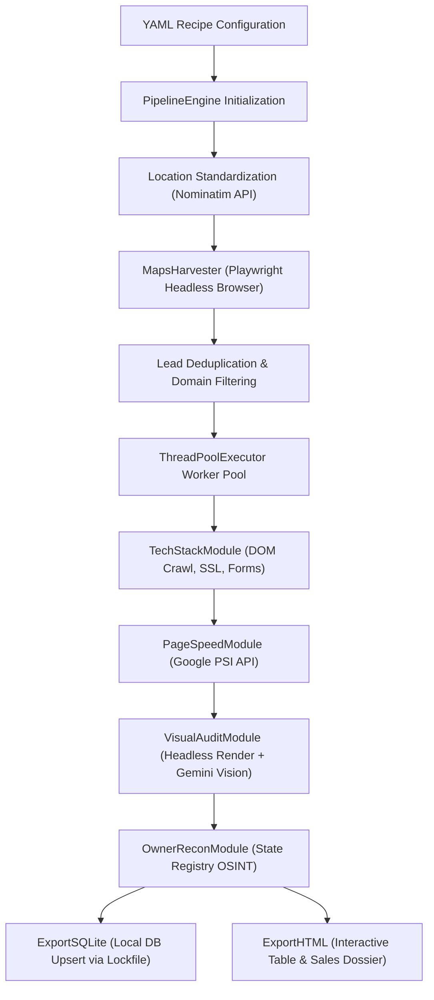

# Local Lead Generator

A modular Python automation pipeline and desktop application that extracts local business records from Google Maps, audits target websites for technical and visual defects, queries public corporate registries, and exports structured dossiers to SQLite and HTML reports.

## The Business Case

Media sales and B2B prospecting operations (such as broadcast television account executives selling commercial advertising schedules) require screening hundreds of local business websites to find viable clients. Sales representatives spend hours manually testing page speeds, hunting for business owners in state registry databases, and verifying contact info across broken web pages. This tool automates the extraction, technical inspection, owner lookup, and contact verification workflow. It bridges raw search queries directly into organized SQLite tables and presentation-ready client dossiers without requiring manual data entry.

## Tech Stack

* **Language**: Python 3.11+
* **Browser Automation & Scraping**: Playwright, `playwright-stealth`, BeautifulSoup4, `cloudscraper`, `requests`
* **Data Modeling & Validation**: Pydantic v2
* **Storage & Concurrency**: SQLite3, JSON flat files, POSIX/Windows file-locking (`os.O_CREAT | os.O_EXCL`), Supabase (PostgreSQL client)
* **External APIs**: Google PageSpeed Insights REST API, Google Gemini API (`google-genai`), Serper API, OpenStreetMap Nominatim API
* **Network & Verification**: `dnspython` (DNS MX lookups), `smtplib` (SMTP handshake validation), Pillow (image manipulation)
* **Desktop UI & Packaging**: CustomTkinter, PyInstaller

---

## Architecture & Logic

### Data Flow



### Core Logic & Fault Tolerance

The application operates as a sequential plugin pipeline orchestrated by `PipelineEngine`. Leads run through a pool of worker threads (`concurrent.futures.ThreadPoolExecutor`). Because external network scraping and external APIs are inherently unstable, the pipeline enforces strict defensive programming across each stage:

#### 1. Pipeline State Control & Early Disqualification
Each harvested entity enters the pipeline wrapped inside a strict Pydantic model (`Lead`). Modules inspect the lead and mutate state fields directly. If a module encounters a non-viable lead (e.g., domain belongs to a franchise blocklist, target site returns HTTP 404/500, or the business matches medical exclusion filters), the module sets `lead.is_disqualified = True`. The `process_lead` execution loop catches this flag and halts execution immediately, preventing unnecessary API calls and compute usage on downstream stages.

#### 2. API Rate Limiting, Serialization, and Quota Failover
Downstream cloud APIs impose aggressive rate limits that break unthrottled concurrent workers:
* **PageSpeed Insights**: The module serializes all HTTP requests through a shared mutex (`threading.Lock`). It adds an explicit 1-second pause between calls. If Google returns HTTP 429, the script catches the code, calculates a randomized backoff delay (`10 + random.uniform(1, 5)` seconds), and retries up to 5 times. If the target URL remains unreachable or exceeds 120 seconds, the module catches the timeout exception and writes an error string to the model instead of raising an uncaught exception.
* **Gemini Vision AI**: Calls to Google's multimodal models run under a global `GEMINI_LOCK` enforcing a 4.5-second delay to guarantee compliance with the 15 requests-per-minute free tier. If the API returns HTTP 429, 503, or quota exhaustion errors, the script pauses for 15 seconds. If rate limits persist after 3 retries (indicating daily quota depletion rather than per-minute throttling), the module automatically downgrades its configured model from `gemini-3.5-flash-lite` to `gemini-3.1-flash-lite` at runtime and resumes the run.

#### 3. Image Dimension Clamping & Headless Browser Recovery
Websites with unconstrained heights (e.g., infinite scrolling pages or broken CSS containers) cause Playwright full-page screenshots to exceed memory limits or crash vision API payload limits. The script passes every captured PNG to Pillow's `enforce_image_limits` function, cropping height to an 8,000-pixel maximum before sending payloads over the network. Network timeouts during page rendering are caught with `try/except Exception` blocks, logging the failure, cleaning up temporary PNG files from the `tmp/` folder, and continuing with the next queue item.

#### 4. Thread-Safe File Locks & Database Conflict Resolution
Concurrent workers write completed records to local SQLite databases and HTML files simultaneously:
* **Atomic File Locks**: Before reading or modifying SQLite tables or HTML summaries, workers acquire a filesystem lock using `os.open(lock_file, os.O_CREAT | os.O_EXCL | os.O_WRONLY)`. Threads poll every 100 milliseconds until the lock releases, execute their disk writes, and remove the lockfile in a `finally` block.
* **SQL Upserts**: The SQLite export layer executes `INSERT INTO leads (...) VALUES (...) ON CONFLICT(website) DO UPDATE SET ...`, preventing duplicate rows when identical domains appear across different search queries.

#### 5. Network Protocol Verification & Data Normalization
* **Location Standardization**: The harvester sends configured target locations to OpenStreetMap Nominatim before harvesting. It respects Nominatim's policy with a mandatory 1.1-second delay, normalizing raw user inputs (such as postal codes or misformatted town names) into standardized `City, State` strings.
* **Email Verification**: When scraping emails from DOM bodies, regex false-positives (e.g., `.png`, `.jpg`, Sentry crash-reporter emails) are stripped via an explicit blocklist. The module then queries DNS MX records using `dnspython` and performs an SMTP handshake (`HELO` -> `MAIL FROM` -> `RCPT TO`) over port 25 without sending an email. Code 250 marks the email as verified, code 550 flags it as a dead bounce, and dropped handshakes fall back safely to `MX_VALID`.

---

## Deployment & Execution

The system supports two execution paths depending on user requirements:

1. **Standalone Desktop Application (Client Mode)**:
   Compiled for Windows into a standalone directory build via PyInstaller (`build.bat`). The executable runs `run_app.py`, which initializes the CustomTkinter GUI dashboard (`gui/app.py`). On first launch, the bootloader automatically checks for and installs the local Chromium Playwright binary. The desktop interface lets users select YAML recipes from a dropdown, enter API credentials into a persistent `.env` manager, and view extracted records inside an isolated SQLite data grid.

2. **Command Line & Automation (Headless Mode)**:
   The tool can run directly via terminal commands or automated schedulers (Windows Task Scheduler, cron):
   ```bash
   python main.py --recipe recipes/web_design.yaml
   ```
   Specific execution parameters can be overridden at runtime via CLI arguments:
   ```bash
   # Single target inspection
   python main.py --url https://example.com --name "Example Services"

   # Override harvest limits and query targets
   python main.py --recipe recipes/job_hunter.yaml --limit 10 --locations "Tampa, FL"
   ```
   At completion, the pipeline cleans up stale lock files and opens the generated HTML report directly in the default web browser.

